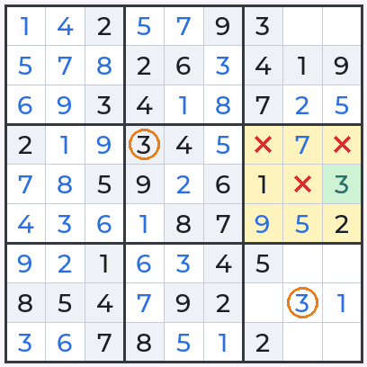

<!-- Written by tools/walkthrough.py anti-knight: edit the script, not this page. -->
# Anti-Knight, step 39: the 3 in box 6

**Step 39 of 49** · [← Step 38](step-38.md) · [All steps](../anti-knight.md#the-whole-puzzle-step-by-step) · [Step 40 →](step-40.md)

Box 6 needs a 3. r4c7 and r4c9: row 4 has one (r4c4). r5c8: column 8 has one (r8c8). Only **r5c9** is left: **r5c9 = 3**.

**Step 39 of 49** · [← Step 38](step-38.md) · [All steps](../anti-knight.md#the-whole-puzzle-step-by-step) · [Step 40 →](step-40.md)
