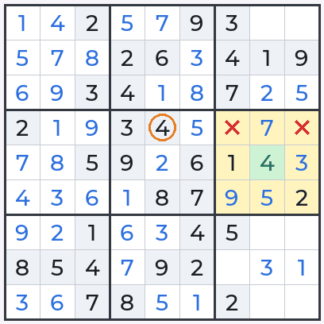

<!-- Written by tools/walkthrough.py anti-knight: edit the script, not this page. -->
# Anti-Knight, step 40: the 4 in box 6

**Step 40 of 49** · [← Step 39](step-39.md) · [All steps](../anti-knight.md#the-whole-puzzle-step-by-step) · [Step 41 →](step-41.md)

Box 6 needs a 4. r4c7 and r4c9: row 4 has one (r4c5). Only **r5c8** is left: **r5c8 = 4**.

**Step 40 of 49** · [← Step 39](step-39.md) · [All steps](../anti-knight.md#the-whole-puzzle-step-by-step) · [Step 41 →](step-41.md)
