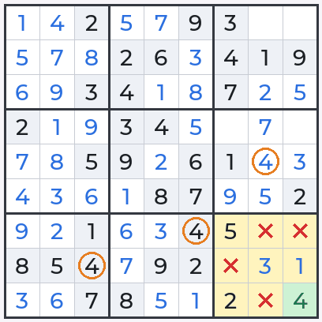

<!-- Written by tools/walkthrough.py anti-knight: edit the script, not this page. -->
# Anti-Knight, step 41: the 4 in box 9

**Step 41 of 49** · [← Step 40](step-40.md) · [All steps](../anti-knight.md#the-whole-puzzle-step-by-step) · [Step 42 →](step-42.md)

Box 9 needs a 4. r7c8 and r7c9: row 7 has one (r7c6). r8c7: row 8 has one (r8c3). r9c8: column 8 has one (r5c8). Only **r9c9** is left: **r9c9 = 4**.

**Step 41 of 49** · [← Step 40](step-40.md) · [All steps](../anti-knight.md#the-whole-puzzle-step-by-step) · [Step 42 →](step-42.md)
