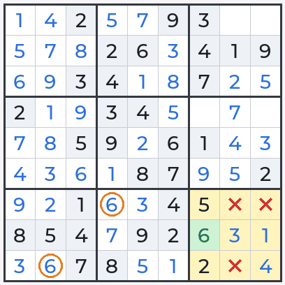

<!-- Written by tools/walkthrough.py anti-knight: edit the script, not this page. -->
# Anti-Knight, step 42: the 6 in box 9

**Step 42 of 49** · [← Step 41](step-41.md) · [All steps](../anti-knight.md#the-whole-puzzle-step-by-step) · [Step 43 →](step-43.md)

Box 9 needs a 6. r7c8 and r7c9: row 7 has one (r7c4). r9c8: row 9 has one (r9c2). Only **r8c7** is left: **r8c7 = 6**.

**Step 42 of 49** · [← Step 41](step-41.md) · [All steps](../anti-knight.md#the-whole-puzzle-step-by-step) · [Step 43 →](step-43.md)
