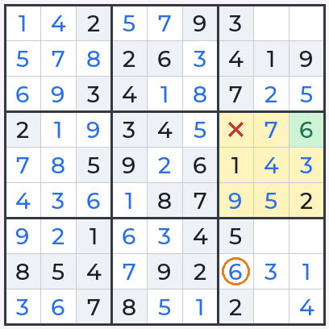

<!-- Written by tools/walkthrough.py anti-knight: edit the script, not this page. -->
# Anti-Knight, step 43: the 6 in box 6

**Step 43 of 49** · [← Step 42](step-42.md) · [All steps](../anti-knight.md#the-whole-puzzle-step-by-step) · [Step 44 →](step-44.md)

Box 6 needs a 6. r4c7: column 7 has one (r8c7). Only **r4c9** is left: **r4c9 = 6**.

**Step 43 of 49** · [← Step 42](step-42.md) · [All steps](../anti-knight.md#the-whole-puzzle-step-by-step) · [Step 44 →](step-44.md)
