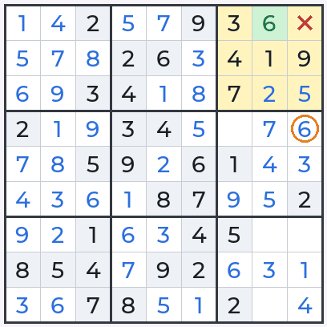

<!-- Written by tools/walkthrough.py anti-knight: edit the script, not this page. -->
# Anti-Knight, step 44: the 6 in box 3

**Step 44 of 49** · [← Step 43](step-43.md) · [All steps](../anti-knight.md#the-whole-puzzle-step-by-step) · [Step 45 →](step-45.md)

Box 3 needs a 6. r1c9: column 9 has one (r4c9). Only **r1c8** is left: **r1c8 = 6**.

**Step 44 of 49** · [← Step 43](step-43.md) · [All steps](../anti-knight.md#the-whole-puzzle-step-by-step) · [Step 45 →](step-45.md)
