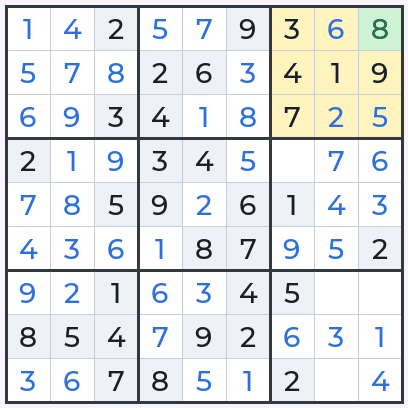

<!-- Written by tools/walkthrough.py anti-knight: edit the script, not this page. -->
# Anti-Knight, step 45: the 8 in box 3

**Step 45 of 49** · [← Step 44](step-44.md) · [All steps](../anti-knight.md#the-whole-puzzle-step-by-step) · [Step 46 →](step-46.md)

Box 3 needs an 8, and r1c9 is its last empty cell: **r1c9 = 8**.

**Step 45 of 49** · [← Step 44](step-44.md) · [All steps](../anti-knight.md#the-whole-puzzle-step-by-step) · [Step 46 →](step-46.md)
