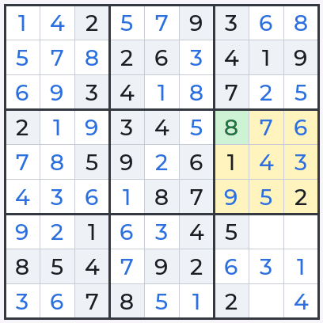

<!-- Written by tools/walkthrough.py anti-knight: edit the script, not this page. -->
# Anti-Knight, step 46: the 8 in box 6

**Step 46 of 49** · [← Step 45](step-45.md) · [All steps](../anti-knight.md#the-whole-puzzle-step-by-step) · [Step 47 →](step-47.md)

Box 6 needs an 8, and r4c7 is its last empty cell: **r4c7 = 8**.

**Step 46 of 49** · [← Step 45](step-45.md) · [All steps](../anti-knight.md#the-whole-puzzle-step-by-step) · [Step 47 →](step-47.md)
