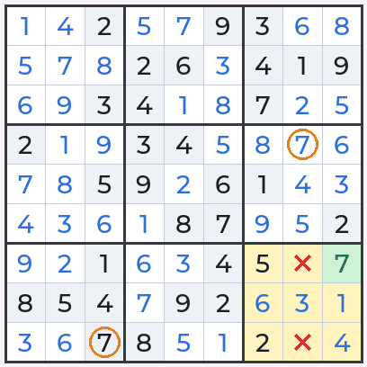

<!-- Written by tools/walkthrough.py anti-knight: edit the script, not this page. -->
# Anti-Knight, step 47: the 7 in box 9

**Step 47 of 49** · [← Step 46](step-46.md) · [All steps](../anti-knight.md#the-whole-puzzle-step-by-step) · [Step 48 →](step-48.md)

Box 9 needs a 7. r7c8: column 8 has one (r4c8). r9c8: row 9 has one (r9c3). Only **r7c9** is left: **r7c9 = 7**.

**Step 47 of 49** · [← Step 46](step-46.md) · [All steps](../anti-knight.md#the-whole-puzzle-step-by-step) · [Step 48 →](step-48.md)
