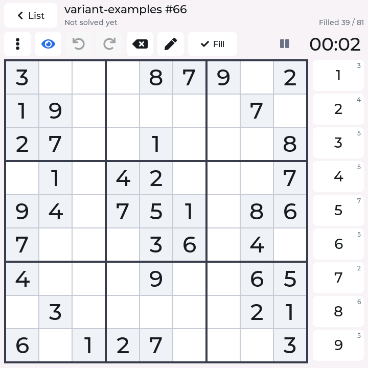
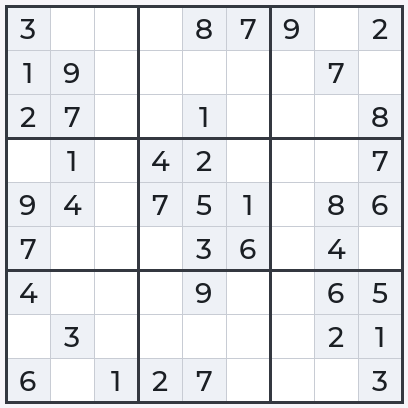

# Anti-Queen 9s

[← All variants](README.md) · [Puzzles](../features-puzzles.md) · [How to play](../how-to-play.md)

## The rules

[Classic](classic.md) rules, and **no two 9s share a diagonal**, of any length: like chess queens, the nine 9s never attack each other along a diagonal (rows and columns already keep them apart). The other digits may repeat on diagonals.

## On the board

- The board looks like Classic's; the **?** button in the top bar has the rule.
- Two 9s on one diagonal turn red.
- The grader and hints know one step: a 9 rules 9 out along both its diagonals. "No two 9s share a diagonal, and row 6, column 4 is on a diagonal of the 9 in row 7, column 5, so it isn't 9."
- **Puzzles → ⋮ → New puzzle → Marks → Anti-Queen 9**.

## How to solve it

- **Cross out the diagonals:** each 9 placed rules 9 out of every cell along its two diagonals, across the whole grid, not just its box.
- **Nine queens:** the nine 9s are nine queens that never attack each other, one in each row, column and box; few patterns do that, so the 9s are often the first digit to finish.
- **Boxes corner to corner:** a 9 in a box's corner rules out the facing corner of the box diagonally next to it.

## Worked example

**variant-examples #66**, Anti-Queen 9s Easy (see [Classic](classic.md#worked-example-the-whole-puzzle) for how to import the examples; cells are written r*row*c*column*).

**Step 1: r6c4.** Row 6 has 7, 3, 6 and 4; column 4 has 4, 7 and 2; box 5 has 4, 2, 7, 5, 1, 3 and 6. By the Classic rules r6c4 could be 8 or 9. But the 9 in r7c5 touches it corner to corner, on one of its diagonals. **r6c4 = 8**.

**Step 2: the 8 in box 1.** Row 1 has an 8 (r1c5), row 3 too (r3c9): only r2c3 is left. **r2c3 = 8**.

**Step 3: the 2 in box 2.** Rows 1 and 3 have their 2s (r1c9, r3c1), and so do columns 4 and 5 (r9c4, r4c5): **r2c6 = 2**.

## The whole puzzle, step by step

<!-- walkthrough -->
<!-- Written by tools/walkthrough.py anti-queen-9s: edit the script, not this part. -->

The whole puzzle, from the start to the last cell: 42 steps, each one a single (one place left for a digit, or one digit left for a cell), taken in the order a box's single comes first, so not quite the order of the worked example above. Each step has a page of its own, with **Previous** and **Next**: pick its number below. In each picture, the unit the step looks at is tinted yellow (for a cell with one digit left: its row, column and box), the new digit is on green, the digits that rule cells out have an **orange ring**, and the empty cells they rule out a **red cross**. Givens are on grey, digits from earlier steps in blue.

| [1](anti-queen-9s/step-01.md) | [2](anti-queen-9s/step-02.md) | [3](anti-queen-9s/step-03.md) | [4](anti-queen-9s/step-04.md) | [5](anti-queen-9s/step-05.md) | [6](anti-queen-9s/step-06.md) | [7](anti-queen-9s/step-07.md) | [8](anti-queen-9s/step-08.md) | [9](anti-queen-9s/step-09.md) | [10](anti-queen-9s/step-10.md) |
|:-:|:-:|:-:|:-:|:-:|:-:|:-:|:-:|:-:|:-:|
| [11](anti-queen-9s/step-11.md) | [12](anti-queen-9s/step-12.md) | [13](anti-queen-9s/step-13.md) | [14](anti-queen-9s/step-14.md) | [15](anti-queen-9s/step-15.md) | [16](anti-queen-9s/step-16.md) | [17](anti-queen-9s/step-17.md) | [18](anti-queen-9s/step-18.md) | [19](anti-queen-9s/step-19.md) | [20](anti-queen-9s/step-20.md) |
| [21](anti-queen-9s/step-21.md) | [22](anti-queen-9s/step-22.md) | [23](anti-queen-9s/step-23.md) | [24](anti-queen-9s/step-24.md) | [25](anti-queen-9s/step-25.md) | [26](anti-queen-9s/step-26.md) | [27](anti-queen-9s/step-27.md) | [28](anti-queen-9s/step-28.md) | [29](anti-queen-9s/step-29.md) | [30](anti-queen-9s/step-30.md) |
| [31](anti-queen-9s/step-31.md) | [32](anti-queen-9s/step-32.md) | [33](anti-queen-9s/step-33.md) | [34](anti-queen-9s/step-34.md) | [35](anti-queen-9s/step-35.md) | [36](anti-queen-9s/step-36.md) | [37](anti-queen-9s/step-37.md) | [38](anti-queen-9s/step-38.md) | [39](anti-queen-9s/step-39.md) | [40](anti-queen-9s/step-40.md) |
| [41](anti-queen-9s/step-41.md) | [42](anti-queen-9s/step-42.md) |  |  |  |  |  |  |  |  |

Solved.

<!-- /walkthrough -->
