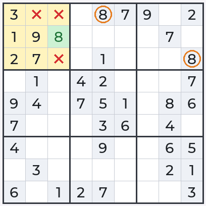

<!-- Written by tools/walkthrough.py anti-queen-9s: edit the script, not this page. -->
# Anti-Queen 9s, step 1: the 8 in box 1

**Step 1 of 42** · [← The start](../anti-queen-9s.md#the-whole-puzzle-step-by-step) · [All steps](../anti-queen-9s.md#the-whole-puzzle-step-by-step) · [Step 2 →](step-02.md)

Box 1 needs an 8. r1c2 and r1c3: row 1 has one (r1c5). r3c3: row 3 has one (r3c9). Only **r2c3** is left: **r2c3 = 8**.

**Step 1 of 42** · [← The start](../anti-queen-9s.md#the-whole-puzzle-step-by-step) · [All steps](../anti-queen-9s.md#the-whole-puzzle-step-by-step) · [Step 2 →](step-02.md)
