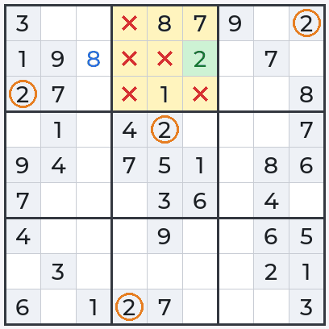

<!-- Written by tools/walkthrough.py anti-queen-9s: edit the script, not this page. -->
# Anti-Queen 9s, step 2: the 2 in box 2

**Step 2 of 42** · [← Step 1](step-01.md) · [All steps](../anti-queen-9s.md#the-whole-puzzle-step-by-step) · [Step 3 →](step-03.md)

Box 2 needs a 2. r1c4: row 1 has one (r1c9). r2c4: column 4 has one (r9c4). r2c5: column 5 has one (r4c5). r3c4 and r3c6: row 3 has one (r3c1). Only **r2c6** is left: **r2c6 = 2**.

**Step 2 of 42** · [← Step 1](step-01.md) · [All steps](../anti-queen-9s.md#the-whole-puzzle-step-by-step) · [Step 3 →](step-03.md)
