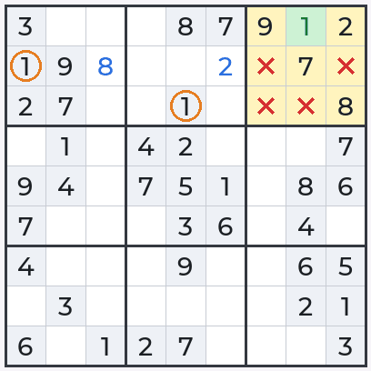

<!-- Written by tools/walkthrough.py anti-queen-9s: edit the script, not this page. -->
# Anti-Queen 9s, step 3: the 1 in box 3

**Step 3 of 42** · [← Step 2](step-02.md) · [All steps](../anti-queen-9s.md#the-whole-puzzle-step-by-step) · [Step 4 →](step-04.md)

Box 3 needs a 1. r2c7 and r2c9: row 2 has one (r2c1). r3c7 and r3c8: row 3 has one (r3c5). Only **r1c8** is left: **r1c8 = 1**.

**Step 3 of 42** · [← Step 2](step-02.md) · [All steps](../anti-queen-9s.md#the-whole-puzzle-step-by-step) · [Step 4 →](step-04.md)
