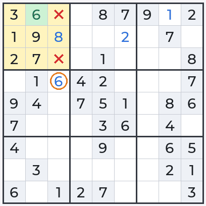

<!-- Written by tools/walkthrough.py anti-queen-9s: edit the script, not this page. -->
# Anti-Queen 9s, step 5: the 6 in box 1

**Step 5 of 42** · [← Step 4](step-04.md) · [All steps](../anti-queen-9s.md#the-whole-puzzle-step-by-step) · [Step 6 →](step-06.md)

Box 1 needs a 6. r1c3 and r3c3: column 3 has one (r4c3). Only **r1c2** is left: **r1c2 = 6**.

**Step 5 of 42** · [← Step 4](step-04.md) · [All steps](../anti-queen-9s.md#the-whole-puzzle-step-by-step) · [Step 6 →](step-06.md)
