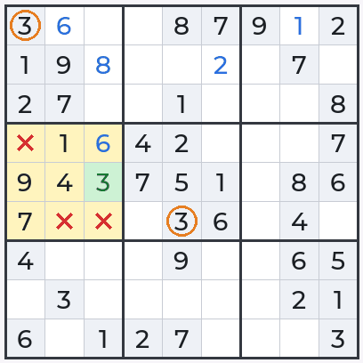

<!-- Written by tools/walkthrough.py anti-queen-9s: edit the script, not this page. -->
# Anti-Queen 9s, step 6: the 3 in box 4

**Step 6 of 42** · [← Step 5](step-05.md) · [All steps](../anti-queen-9s.md#the-whole-puzzle-step-by-step) · [Step 7 →](step-07.md)

Box 4 needs a 3. r4c1: column 1 has one (r1c1). r6c2 and r6c3: row 6 has one (r6c5). Only **r5c3** is left: **r5c3 = 3**.

**Step 6 of 42** · [← Step 5](step-05.md) · [All steps](../anti-queen-9s.md#the-whole-puzzle-step-by-step) · [Step 7 →](step-07.md)
