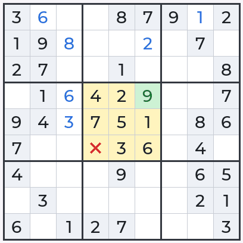

<!-- Written by tools/walkthrough.py anti-queen-9s: edit the script, not this page. -->
# Anti-Queen 9s, step 7: the 9 in box 5

**Step 7 of 42** · [← Step 6](step-06.md) · [All steps](../anti-queen-9s.md#the-whole-puzzle-step-by-step) · [Step 8 →](step-08.md)

Box 5 needs a 9. r6c4: the 9 in r7c5 is on a diagonal with it. Only **r4c6** is left: **r4c6 = 9**.

**Step 7 of 42** · [← Step 6](step-06.md) · [All steps](../anti-queen-9s.md#the-whole-puzzle-step-by-step) · [Step 8 →](step-08.md)
