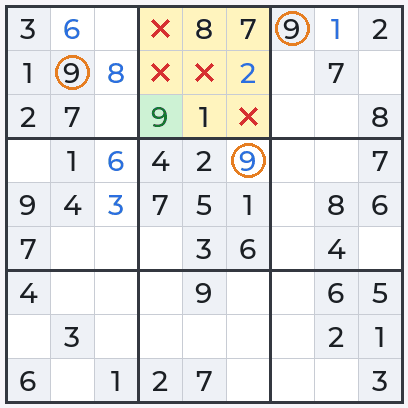

<!-- Written by tools/walkthrough.py anti-queen-9s: edit the script, not this page. -->
# Anti-Queen 9s, step 8: the 9 in box 2

**Step 8 of 42** · [← Step 7](step-07.md) · [All steps](../anti-queen-9s.md#the-whole-puzzle-step-by-step) · [Step 9 →](step-09.md)

Box 2 needs a 9. r1c4: row 1 has one (r1c7). r2c4 and r2c5: row 2 has one (r2c2). r3c6: column 6 has one (r4c6). Only **r3c4** is left: **r3c4 = 9**.

**Step 8 of 42** · [← Step 7](step-07.md) · [All steps](../anti-queen-9s.md#the-whole-puzzle-step-by-step) · [Step 9 →](step-09.md)
