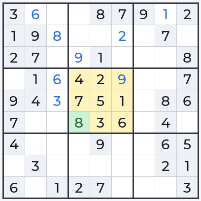

<!-- Written by tools/walkthrough.py anti-queen-9s: edit the script, not this page. -->
# Anti-Queen 9s, step 9: the 8 in box 5

**Step 9 of 42** · [← Step 8](step-08.md) · [All steps](../anti-queen-9s.md#the-whole-puzzle-step-by-step) · [Step 10 →](step-10.md)

Box 5 needs an 8, and r6c4 is its last empty cell: **r6c4 = 8**.

**Step 9 of 42** · [← Step 8](step-08.md) · [All steps](../anti-queen-9s.md#the-whole-puzzle-step-by-step) · [Step 10 →](step-10.md)
