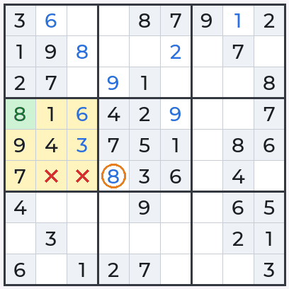

<!-- Written by tools/walkthrough.py anti-queen-9s: edit the script, not this page. -->
# Anti-Queen 9s, step 10: the 8 in box 4

**Step 10 of 42** · [← Step 9](step-09.md) · [All steps](../anti-queen-9s.md#the-whole-puzzle-step-by-step) · [Step 11 →](step-11.md)

Box 4 needs an 8. r6c2 and r6c3: row 6 has one (r6c4). Only **r4c1** is left: **r4c1 = 8**.

**Step 10 of 42** · [← Step 9](step-09.md) · [All steps](../anti-queen-9s.md#the-whole-puzzle-step-by-step) · [Step 11 →](step-11.md)
