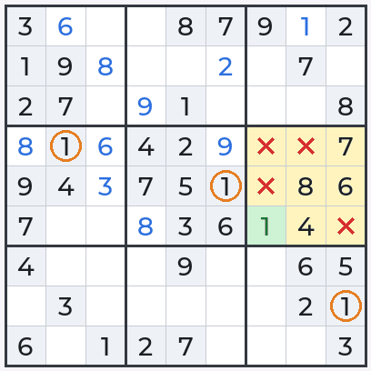

<!-- Written by tools/walkthrough.py anti-queen-9s: edit the script, not this page. -->
# Anti-Queen 9s, step 11: the 1 in box 6

**Step 11 of 42** · [← Step 10](step-10.md) · [All steps](../anti-queen-9s.md#the-whole-puzzle-step-by-step) · [Step 12 →](step-12.md)

Box 6 needs a 1. r4c7 and r4c8: row 4 has one (r4c2). r5c7: row 5 has one (r5c6). r6c9: column 9 has one (r8c9). Only **r6c7** is left: **r6c7 = 1**.

**Step 11 of 42** · [← Step 10](step-10.md) · [All steps](../anti-queen-9s.md#the-whole-puzzle-step-by-step) · [Step 12 →](step-12.md)
