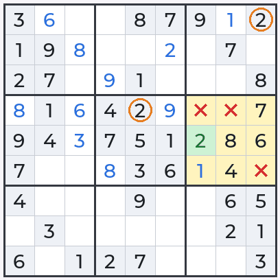

<!-- Written by tools/walkthrough.py anti-queen-9s: edit the script, not this page. -->
# Anti-Queen 9s, step 12: the 2 in box 6

**Step 12 of 42** · [← Step 11](step-11.md) · [All steps](../anti-queen-9s.md#the-whole-puzzle-step-by-step) · [Step 13 →](step-13.md)

Box 6 needs a 2. r4c7 and r4c8: row 4 has one (r4c5). r6c9: column 9 has one (r1c9). Only **r5c7** is left: **r5c7 = 2**.

**Step 12 of 42** · [← Step 11](step-11.md) · [All steps](../anti-queen-9s.md#the-whole-puzzle-step-by-step) · [Step 13 →](step-13.md)
