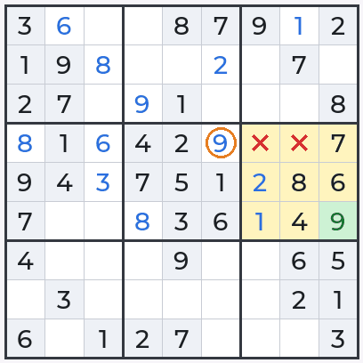

<!-- Written by tools/walkthrough.py anti-queen-9s: edit the script, not this page. -->
# Anti-Queen 9s, step 13: the 9 in box 6

**Step 13 of 42** · [← Step 12](step-12.md) · [All steps](../anti-queen-9s.md#the-whole-puzzle-step-by-step) · [Step 14 →](step-14.md)

Box 6 needs a 9. r4c7 and r4c8: row 4 has one (r4c6). Only **r6c9** is left: **r6c9 = 9**.

**Step 13 of 42** · [← Step 12](step-12.md) · [All steps](../anti-queen-9s.md#the-whole-puzzle-step-by-step) · [Step 14 →](step-14.md)
