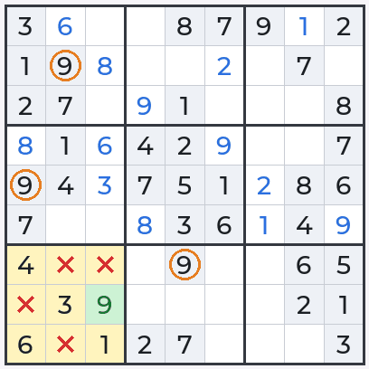

<!-- Written by tools/walkthrough.py anti-queen-9s: edit the script, not this page. -->
# Anti-Queen 9s, step 14: the 9 in box 7

**Step 14 of 42** · [← Step 13](step-13.md) · [All steps](../anti-queen-9s.md#the-whole-puzzle-step-by-step) · [Step 15 →](step-15.md)

Box 7 needs a 9. r7c2 and r7c3: row 7 has one (r7c5). r8c1: column 1 has one (r5c1). r9c2: column 2 has one (r2c2). Only **r8c3** is left: **r8c3 = 9**.

**Step 14 of 42** · [← Step 13](step-13.md) · [All steps](../anti-queen-9s.md#the-whole-puzzle-step-by-step) · [Step 15 →](step-15.md)
