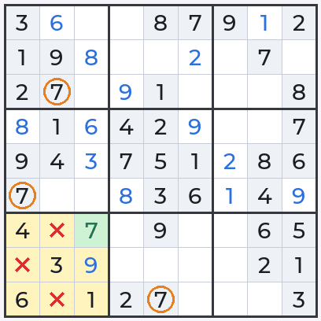

<!-- Written by tools/walkthrough.py anti-queen-9s: edit the script, not this page. -->
# Anti-Queen 9s, step 15: the 7 in box 7

**Step 15 of 42** · [← Step 14](step-14.md) · [All steps](../anti-queen-9s.md#the-whole-puzzle-step-by-step) · [Step 16 →](step-16.md)

Box 7 needs a 7. r7c2: column 2 has one (r3c2). r8c1: column 1 has one (r6c1). r9c2: row 9 has one (r9c5). Only **r7c3** is left: **r7c3 = 7**.

**Step 15 of 42** · [← Step 14](step-14.md) · [All steps](../anti-queen-9s.md#the-whole-puzzle-step-by-step) · [Step 16 →](step-16.md)
