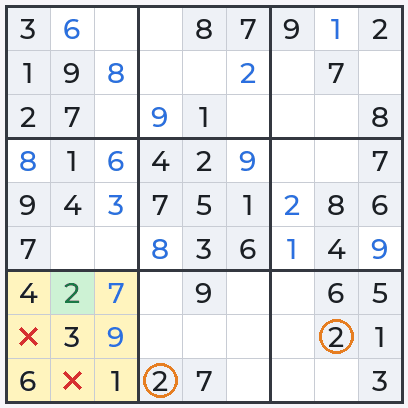

<!-- Written by tools/walkthrough.py anti-queen-9s: edit the script, not this page. -->
# Anti-Queen 9s, step 16: the 2 in box 7

**Step 16 of 42** · [← Step 15](step-15.md) · [All steps](../anti-queen-9s.md#the-whole-puzzle-step-by-step) · [Step 17 →](step-17.md)

Box 7 needs a 2. r8c1: row 8 has one (r8c8). r9c2: row 9 has one (r9c4). Only **r7c2** is left: **r7c2 = 2**.

**Step 16 of 42** · [← Step 15](step-15.md) · [All steps](../anti-queen-9s.md#the-whole-puzzle-step-by-step) · [Step 17 →](step-17.md)
