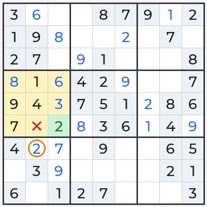

<!-- Written by tools/walkthrough.py anti-queen-9s: edit the script, not this page. -->
# Anti-Queen 9s, step 17: the 2 in box 4

**Step 17 of 42** · [← Step 16](step-16.md) · [All steps](../anti-queen-9s.md#the-whole-puzzle-step-by-step) · [Step 18 →](step-18.md)

Box 4 needs a 2. r6c2: column 2 has one (r7c2). Only **r6c3** is left: **r6c3 = 2**.

**Step 17 of 42** · [← Step 16](step-16.md) · [All steps](../anti-queen-9s.md#the-whole-puzzle-step-by-step) · [Step 18 →](step-18.md)
