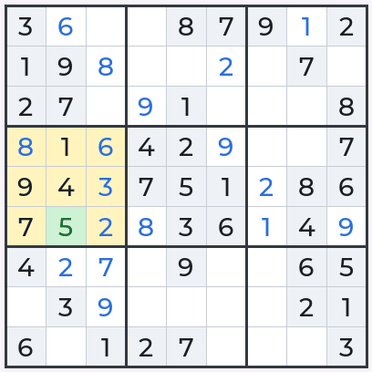

<!-- Written by tools/walkthrough.py anti-queen-9s: edit the script, not this page. -->
# Anti-Queen 9s, step 18: the 5 in box 4

**Step 18 of 42** · [← Step 17](step-17.md) · [All steps](../anti-queen-9s.md#the-whole-puzzle-step-by-step) · [Step 19 →](step-19.md)

Box 4 needs a 5, and r6c2 is its last empty cell: **r6c2 = 5**.

**Step 18 of 42** · [← Step 17](step-17.md) · [All steps](../anti-queen-9s.md#the-whole-puzzle-step-by-step) · [Step 19 →](step-19.md)
