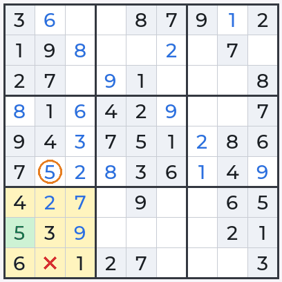

<!-- Written by tools/walkthrough.py anti-queen-9s: edit the script, not this page. -->
# Anti-Queen 9s, step 19: the 5 in box 7

**Step 19 of 42** · [← Step 18](step-18.md) · [All steps](../anti-queen-9s.md#the-whole-puzzle-step-by-step) · [Step 20 →](step-20.md)

Box 7 needs a 5. r9c2: column 2 has one (r6c2). Only **r8c1** is left: **r8c1 = 5**.

**Step 19 of 42** · [← Step 18](step-18.md) · [All steps](../anti-queen-9s.md#the-whole-puzzle-step-by-step) · [Step 20 →](step-20.md)
