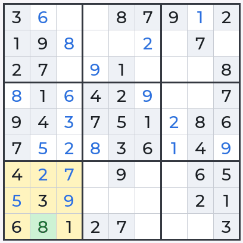

<!-- Written by tools/walkthrough.py anti-queen-9s: edit the script, not this page. -->
# Anti-Queen 9s, step 20: the 8 in box 7

**Step 20 of 42** · [← Step 19](step-19.md) · [All steps](../anti-queen-9s.md#the-whole-puzzle-step-by-step) · [Step 21 →](step-21.md)

Box 7 needs an 8, and r9c2 is its last empty cell: **r9c2 = 8**.

**Step 20 of 42** · [← Step 19](step-19.md) · [All steps](../anti-queen-9s.md#the-whole-puzzle-step-by-step) · [Step 21 →](step-21.md)
