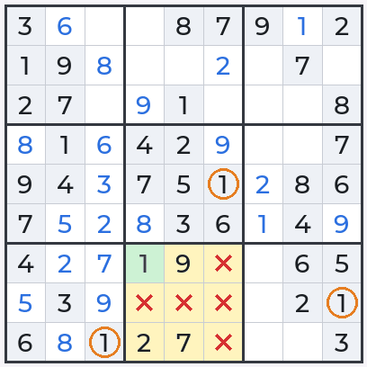

<!-- Written by tools/walkthrough.py anti-queen-9s: edit the script, not this page. -->
# Anti-Queen 9s, step 21: the 1 in box 8

**Step 21 of 42** · [← Step 20](step-20.md) · [All steps](../anti-queen-9s.md#the-whole-puzzle-step-by-step) · [Step 22 →](step-22.md)

Box 8 needs a 1. r7c6: column 6 has one (r5c6). r8c4, r8c5 and r8c6: row 8 has one (r8c9). r9c6: row 9 has one (r9c3). Only **r7c4** is left: **r7c4 = 1**.

**Step 21 of 42** · [← Step 20](step-20.md) · [All steps](../anti-queen-9s.md#the-whole-puzzle-step-by-step) · [Step 22 →](step-22.md)
