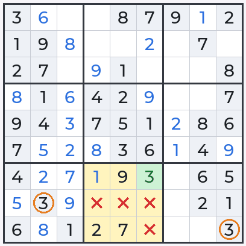

<!-- Written by tools/walkthrough.py anti-queen-9s: edit the script, not this page. -->
# Anti-Queen 9s, step 22: the 3 in box 8

**Step 22 of 42** · [← Step 21](step-21.md) · [All steps](../anti-queen-9s.md#the-whole-puzzle-step-by-step) · [Step 23 →](step-23.md)

Box 8 needs a 3. r8c4, r8c5 and r8c6: row 8 has one (r8c2). r9c6: row 9 has one (r9c9). Only **r7c6** is left: **r7c6 = 3**.

**Step 22 of 42** · [← Step 21](step-21.md) · [All steps](../anti-queen-9s.md#the-whole-puzzle-step-by-step) · [Step 23 →](step-23.md)
