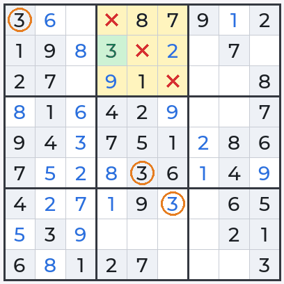

<!-- Written by tools/walkthrough.py anti-queen-9s: edit the script, not this page. -->
# Anti-Queen 9s, step 23: the 3 in box 2

**Step 23 of 42** · [← Step 22](step-22.md) · [All steps](../anti-queen-9s.md#the-whole-puzzle-step-by-step) · [Step 24 →](step-24.md)

Box 2 needs a 3. r1c4: row 1 has one (r1c1). r2c5: column 5 has one (r6c5). r3c6: column 6 has one (r7c6). Only **r2c4** is left: **r2c4 = 3**.

**Step 23 of 42** · [← Step 22](step-22.md) · [All steps](../anti-queen-9s.md#the-whole-puzzle-step-by-step) · [Step 24 →](step-24.md)
