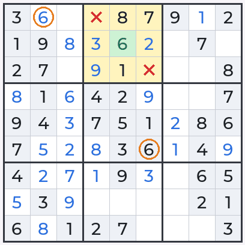

<!-- Written by tools/walkthrough.py anti-queen-9s: edit the script, not this page. -->
# Anti-Queen 9s, step 24: the 6 in box 2

**Step 24 of 42** · [← Step 23](step-23.md) · [All steps](../anti-queen-9s.md#the-whole-puzzle-step-by-step) · [Step 25 →](step-25.md)

Box 2 needs a 6. r1c4: row 1 has one (r1c2). r3c6: column 6 has one (r6c6). Only **r2c5** is left: **r2c5 = 6**.

**Step 24 of 42** · [← Step 23](step-23.md) · [All steps](../anti-queen-9s.md#the-whole-puzzle-step-by-step) · [Step 25 →](step-25.md)
