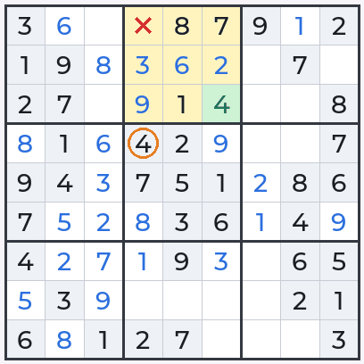

<!-- Written by tools/walkthrough.py anti-queen-9s: edit the script, not this page. -->
# Anti-Queen 9s, step 25: the 4 in box 2

**Step 25 of 42** · [← Step 24](step-24.md) · [All steps](../anti-queen-9s.md#the-whole-puzzle-step-by-step) · [Step 26 →](step-26.md)

Box 2 needs a 4. r1c4: column 4 has one (r4c4). Only **r3c6** is left: **r3c6 = 4**.

**Step 25 of 42** · [← Step 24](step-24.md) · [All steps](../anti-queen-9s.md#the-whole-puzzle-step-by-step) · [Step 26 →](step-26.md)
