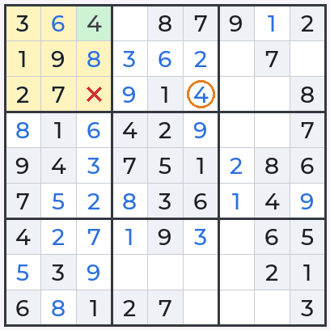

<!-- Written by tools/walkthrough.py anti-queen-9s: edit the script, not this page. -->
# Anti-Queen 9s, step 26: the 4 in box 1

**Step 26 of 42** · [← Step 25](step-25.md) · [All steps](../anti-queen-9s.md#the-whole-puzzle-step-by-step) · [Step 27 →](step-27.md)

Box 1 needs a 4. r3c3: row 3 has one (r3c6). Only **r1c3** is left: **r1c3 = 4**.

**Step 26 of 42** · [← Step 25](step-25.md) · [All steps](../anti-queen-9s.md#the-whole-puzzle-step-by-step) · [Step 27 →](step-27.md)
