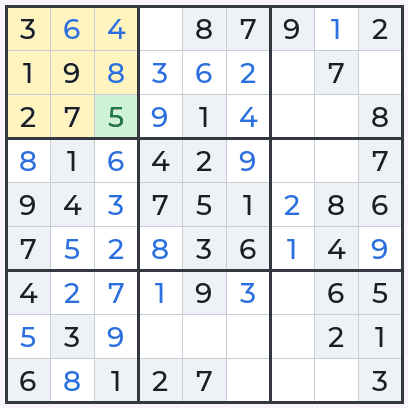

<!-- Written by tools/walkthrough.py anti-queen-9s: edit the script, not this page. -->
# Anti-Queen 9s, step 27: the 5 in box 1

**Step 27 of 42** · [← Step 26](step-26.md) · [All steps](../anti-queen-9s.md#the-whole-puzzle-step-by-step) · [Step 28 →](step-28.md)

Box 1 needs a 5, and r3c3 is its last empty cell: **r3c3 = 5**.

**Step 27 of 42** · [← Step 26](step-26.md) · [All steps](../anti-queen-9s.md#the-whole-puzzle-step-by-step) · [Step 28 →](step-28.md)
