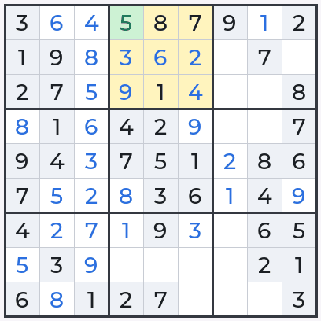

<!-- Written by tools/walkthrough.py anti-queen-9s: edit the script, not this page. -->
# Anti-Queen 9s, step 28: the 5 in box 2

**Step 28 of 42** · [← Step 27](step-27.md) · [All steps](../anti-queen-9s.md#the-whole-puzzle-step-by-step) · [Step 29 →](step-29.md)

Box 2 needs a 5, and r1c4 is its last empty cell: **r1c4 = 5**.

**Step 28 of 42** · [← Step 27](step-27.md) · [All steps](../anti-queen-9s.md#the-whole-puzzle-step-by-step) · [Step 29 →](step-29.md)
