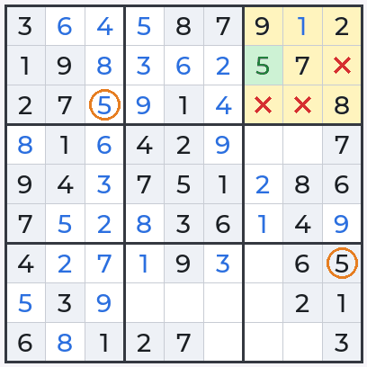

<!-- Written by tools/walkthrough.py anti-queen-9s: edit the script, not this page. -->
# Anti-Queen 9s, step 29: the 5 in box 3

**Step 29 of 42** · [← Step 28](step-28.md) · [All steps](../anti-queen-9s.md#the-whole-puzzle-step-by-step) · [Step 30 →](step-30.md)

Box 3 needs a 5. r2c9: column 9 has one (r7c9). r3c7 and r3c8: row 3 has one (r3c3). Only **r2c7** is left: **r2c7 = 5**.

**Step 29 of 42** · [← Step 28](step-28.md) · [All steps](../anti-queen-9s.md#the-whole-puzzle-step-by-step) · [Step 30 →](step-30.md)
