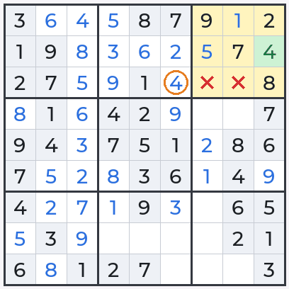

<!-- Written by tools/walkthrough.py anti-queen-9s: edit the script, not this page. -->
# Anti-Queen 9s, step 30: the 4 in box 3

**Step 30 of 42** · [← Step 29](step-29.md) · [All steps](../anti-queen-9s.md#the-whole-puzzle-step-by-step) · [Step 31 →](step-31.md)

Box 3 needs a 4. r3c7 and r3c8: row 3 has one (r3c6). Only **r2c9** is left: **r2c9 = 4**.

**Step 30 of 42** · [← Step 29](step-29.md) · [All steps](../anti-queen-9s.md#the-whole-puzzle-step-by-step) · [Step 31 →](step-31.md)
