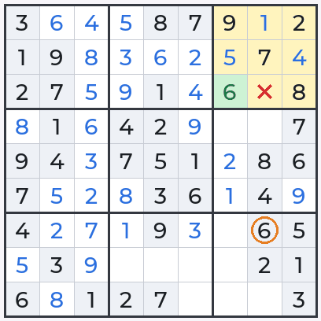

<!-- Written by tools/walkthrough.py anti-queen-9s: edit the script, not this page. -->
# Anti-Queen 9s, step 31: the 6 in box 3

**Step 31 of 42** · [← Step 30](step-30.md) · [All steps](../anti-queen-9s.md#the-whole-puzzle-step-by-step) · [Step 32 →](step-32.md)

Box 3 needs a 6. r3c8: column 8 has one (r7c8). Only **r3c7** is left: **r3c7 = 6**.

**Step 31 of 42** · [← Step 30](step-30.md) · [All steps](../anti-queen-9s.md#the-whole-puzzle-step-by-step) · [Step 32 →](step-32.md)
