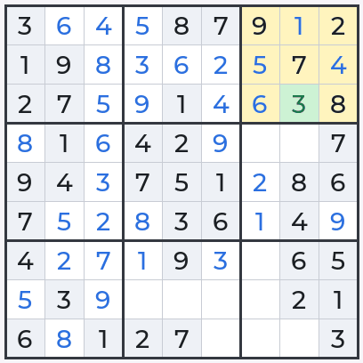

<!-- Written by tools/walkthrough.py anti-queen-9s: edit the script, not this page. -->
# Anti-Queen 9s, step 32: the 3 in box 3

**Step 32 of 42** · [← Step 31](step-31.md) · [All steps](../anti-queen-9s.md#the-whole-puzzle-step-by-step) · [Step 33 →](step-33.md)

Box 3 needs a 3, and r3c8 is its last empty cell: **r3c8 = 3**.

**Step 32 of 42** · [← Step 31](step-31.md) · [All steps](../anti-queen-9s.md#the-whole-puzzle-step-by-step) · [Step 33 →](step-33.md)
