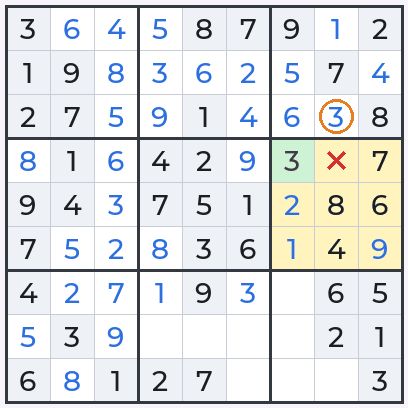

<!-- Written by tools/walkthrough.py anti-queen-9s: edit the script, not this page. -->
# Anti-Queen 9s, step 33: the 3 in box 6

**Step 33 of 42** · [← Step 32](step-32.md) · [All steps](../anti-queen-9s.md#the-whole-puzzle-step-by-step) · [Step 34 →](step-34.md)

Box 6 needs a 3. r4c8: column 8 has one (r3c8). Only **r4c7** is left: **r4c7 = 3**.

**Step 33 of 42** · [← Step 32](step-32.md) · [All steps](../anti-queen-9s.md#the-whole-puzzle-step-by-step) · [Step 34 →](step-34.md)
