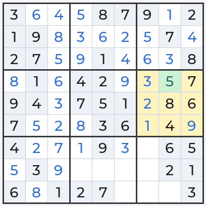

<!-- Written by tools/walkthrough.py anti-queen-9s: edit the script, not this page. -->
# Anti-Queen 9s, step 34: the 5 in box 6

**Step 34 of 42** · [← Step 33](step-33.md) · [All steps](../anti-queen-9s.md#the-whole-puzzle-step-by-step) · [Step 35 →](step-35.md)

Box 6 needs a 5, and r4c8 is its last empty cell: **r4c8 = 5**.

**Step 34 of 42** · [← Step 33](step-33.md) · [All steps](../anti-queen-9s.md#the-whole-puzzle-step-by-step) · [Step 35 →](step-35.md)
