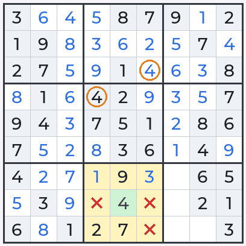

<!-- Written by tools/walkthrough.py anti-queen-9s: edit the script, not this page. -->
# Anti-Queen 9s, step 35: the 4 in box 8

**Step 35 of 42** · [← Step 34](step-34.md) · [All steps](../anti-queen-9s.md#the-whole-puzzle-step-by-step) · [Step 36 →](step-36.md)

Box 8 needs a 4. r8c4: column 4 has one (r4c4). r8c6 and r9c6: column 6 has one (r3c6). Only **r8c5** is left: **r8c5 = 4**.

**Step 35 of 42** · [← Step 34](step-34.md) · [All steps](../anti-queen-9s.md#the-whole-puzzle-step-by-step) · [Step 36 →](step-36.md)
