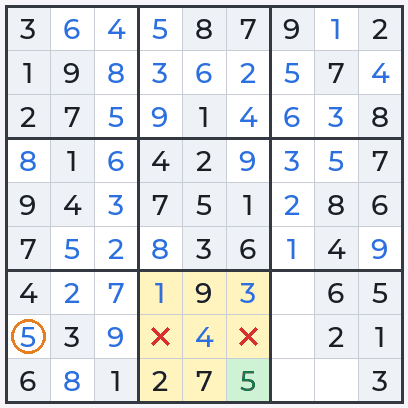

<!-- Written by tools/walkthrough.py anti-queen-9s: edit the script, not this page. -->
# Anti-Queen 9s, step 36: the 5 in box 8

**Step 36 of 42** · [← Step 35](step-35.md) · [All steps](../anti-queen-9s.md#the-whole-puzzle-step-by-step) · [Step 37 →](step-37.md)

Box 8 needs a 5. r8c4 and r8c6: row 8 has one (r8c1). Only **r9c6** is left: **r9c6 = 5**.

**Step 36 of 42** · [← Step 35](step-35.md) · [All steps](../anti-queen-9s.md#the-whole-puzzle-step-by-step) · [Step 37 →](step-37.md)
