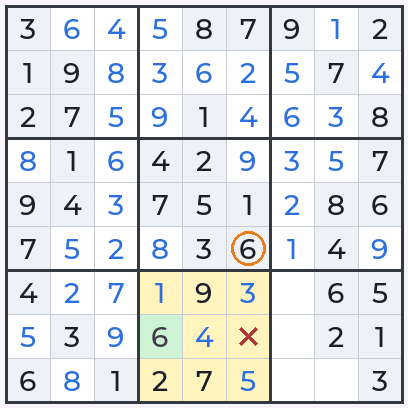

<!-- Written by tools/walkthrough.py anti-queen-9s: edit the script, not this page. -->
# Anti-Queen 9s, step 37: the 6 in box 8

**Step 37 of 42** · [← Step 36](step-36.md) · [All steps](../anti-queen-9s.md#the-whole-puzzle-step-by-step) · [Step 38 →](step-38.md)

Box 8 needs a 6. r8c6: column 6 has one (r6c6). Only **r8c4** is left: **r8c4 = 6**.

**Step 37 of 42** · [← Step 36](step-36.md) · [All steps](../anti-queen-9s.md#the-whole-puzzle-step-by-step) · [Step 38 →](step-38.md)
