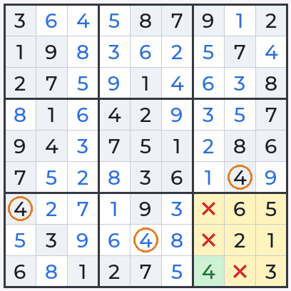

<!-- Written by tools/walkthrough.py anti-queen-9s: edit the script, not this page. -->
# Anti-Queen 9s, step 39: the 4 in box 9

**Step 39 of 42** · [← Step 38](step-38.md) · [All steps](../anti-queen-9s.md#the-whole-puzzle-step-by-step) · [Step 40 →](step-40.md)

Box 9 needs a 4. r7c7: row 7 has one (r7c1). r8c7: row 8 has one (r8c5). r9c8: column 8 has one (r6c8). Only **r9c7** is left: **r9c7 = 4**.

**Step 39 of 42** · [← Step 38](step-38.md) · [All steps](../anti-queen-9s.md#the-whole-puzzle-step-by-step) · [Step 40 →](step-40.md)
