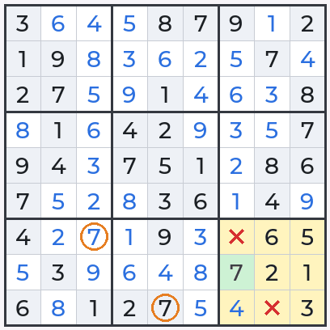

<!-- Written by tools/walkthrough.py anti-queen-9s: edit the script, not this page. -->
# Anti-Queen 9s, step 40: the 7 in box 9

**Step 40 of 42** · [← Step 39](step-39.md) · [All steps](../anti-queen-9s.md#the-whole-puzzle-step-by-step) · [Step 41 →](step-41.md)

Box 9 needs a 7. r7c7: row 7 has one (r7c3). r9c8: row 9 has one (r9c5). Only **r8c7** is left: **r8c7 = 7**.

**Step 40 of 42** · [← Step 39](step-39.md) · [All steps](../anti-queen-9s.md#the-whole-puzzle-step-by-step) · [Step 41 →](step-41.md)
