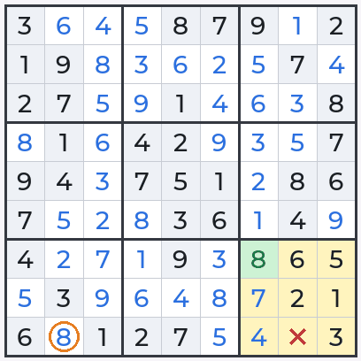

<!-- Written by tools/walkthrough.py anti-queen-9s: edit the script, not this page. -->
# Anti-Queen 9s, step 41: the 8 in box 9

**Step 41 of 42** · [← Step 40](step-40.md) · [All steps](../anti-queen-9s.md#the-whole-puzzle-step-by-step) · [Step 42 →](step-42.md)

Box 9 needs an 8. r9c8: row 9 has one (r9c2). Only **r7c7** is left: **r7c7 = 8**.

**Step 41 of 42** · [← Step 40](step-40.md) · [All steps](../anti-queen-9s.md#the-whole-puzzle-step-by-step) · [Step 42 →](step-42.md)
