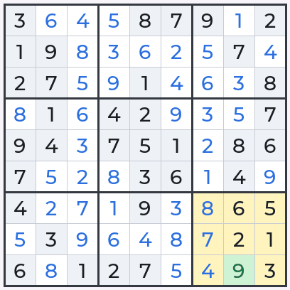

<!-- Written by tools/walkthrough.py anti-queen-9s: edit the script, not this page. -->
# Anti-Queen 9s, step 42: the 9 in box 9

**Step 42 of 42** · [← Step 41](step-41.md) · [All steps](../anti-queen-9s.md#the-whole-puzzle-step-by-step) · [All steps](../anti-queen-9s.md#the-whole-puzzle-step-by-step)

Box 9 needs a 9, and r9c8 is its last empty cell: **r9c8 = 9**.

Solved.

**Step 42 of 42** · [← Step 41](step-41.md) · [All steps](../anti-queen-9s.md#the-whole-puzzle-step-by-step) · [All steps](../anti-queen-9s.md#the-whole-puzzle-step-by-step)
